 

  
  
  # Hey, I'm Onur! 👋
  **Computer Engineering Student**
  
  İzmir, Türkiye
  
  *Building, learning, and experimenting with code.*

---

### 👨‍💻 About Me

- 🎓 Computer Engineering student at İzmir Institute of Technology (İYTE).
- 💻 Interested in software development, algorithms, and problem solving.
- 🤖 Exploring artificial intelligence and automation.
- 🌱 Always learning and building new things.

### 🛠️ Technologies

- **Languages:** Java, Python
- **Interests:** Object-Oriented Programming, Algorithms, AI, Software Engineering

### 📊 GitHub Activity

  
   
  

---

  *Thanks for stopping by!*

